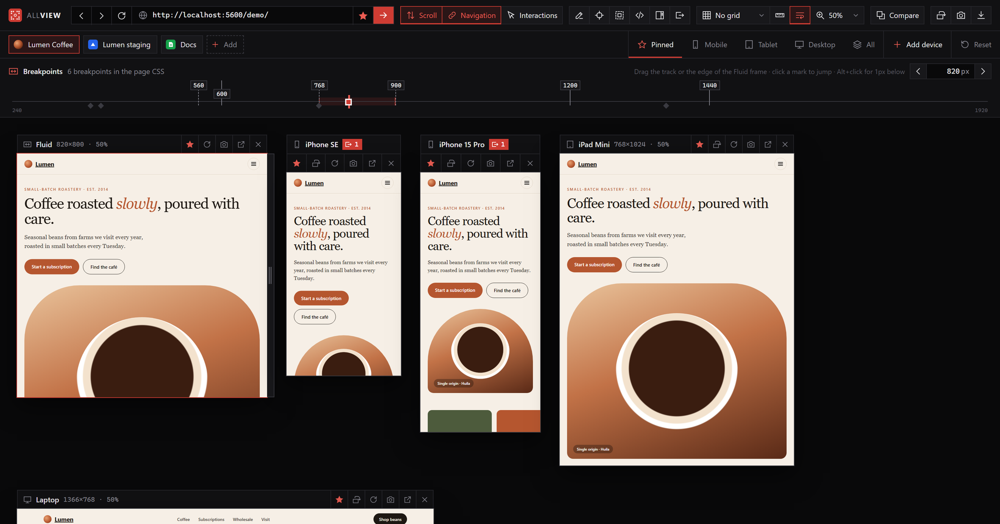
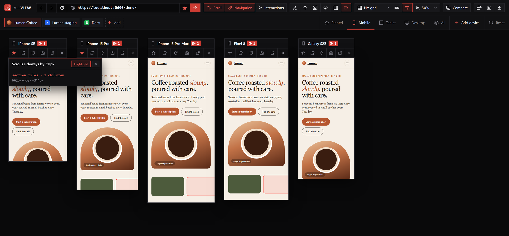
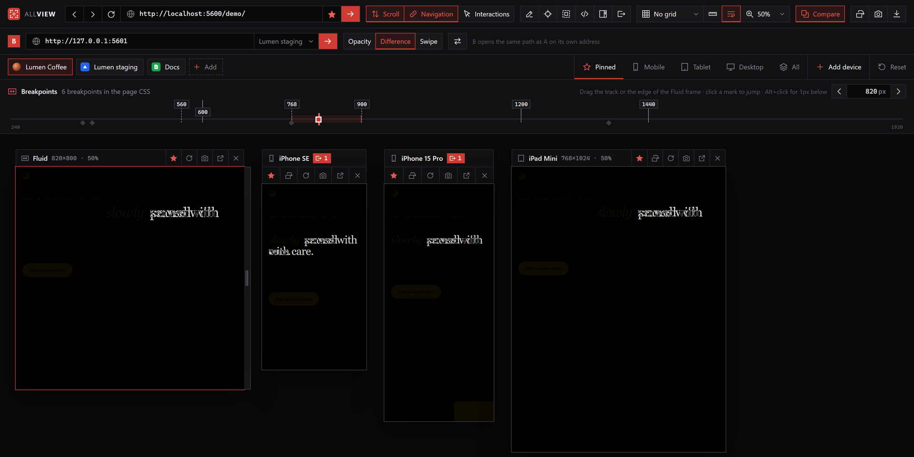
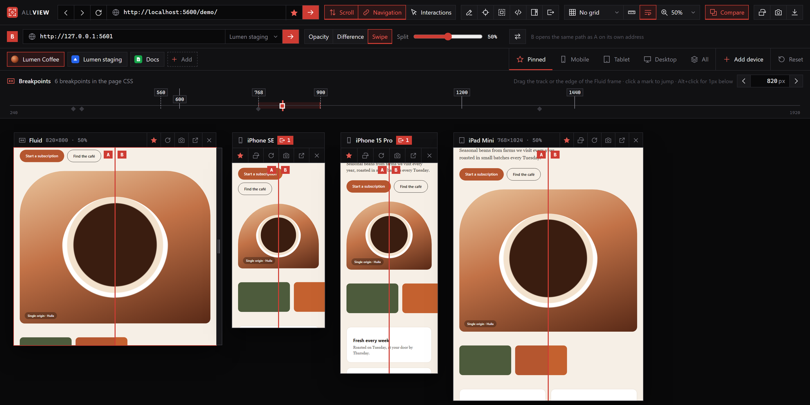
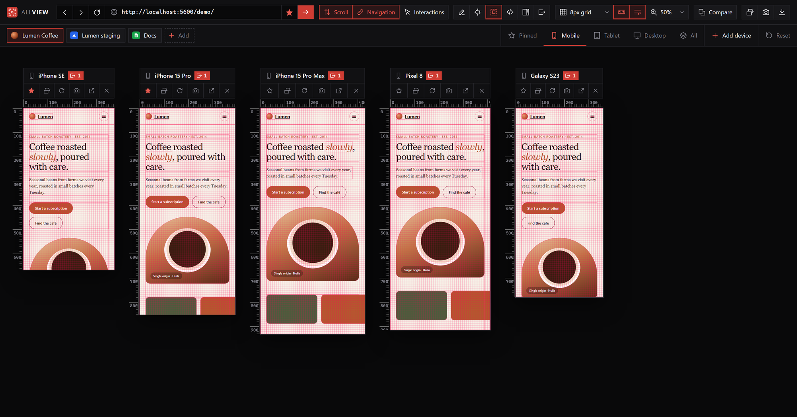
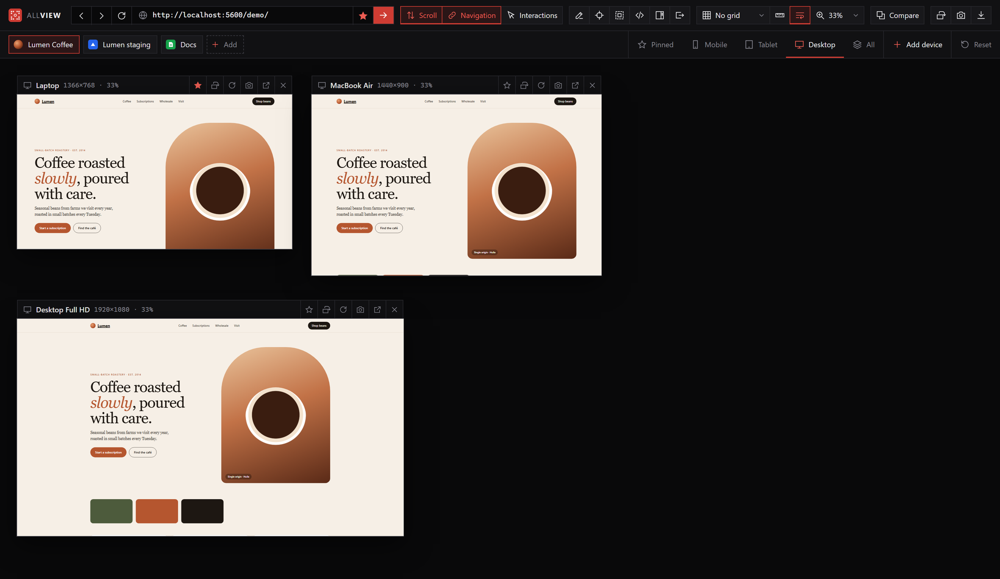
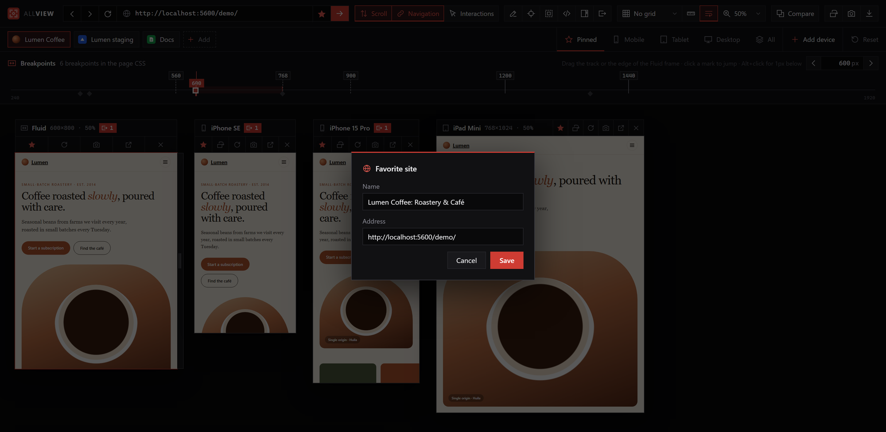

<div align="center">


# AllView

See one page on every screen size at once. Scroll, click and navigate on one device and the others follow.


<br>



</div>

---

## Overview

AllView is a browser extension for checking responsive layouts. It opens a tab with the page you are on rendered inside several device frames (phones, tablets, laptops, desktops), all live and all in sync.

It is plain HTML, CSS and JavaScript. No framework, no bundler, no dependencies, nothing to install besides the extension itself.

---

## Features

* **Every device at once:** 12 built-in devices from iPhone SE to Full HD desktop, plus your own custom sizes. Rotate any of them to landscape.
* **Breakpoint bar and Fluid device:** AllView reads the page's media queries and marks every width breakpoint on a track. Drag the track, or the edge of the Fluid frame, to resize it live, or click a mark to land exactly on it.
* **Overflow detector:** every device shows a badge when the page scrolls sideways, with a list of the elements to blame. Click one to scroll to it and outline it.
* **Compare A with B:** load a second site (staging, a branch preview, production) on top of every device, in *Opacity*, *Difference* or *Swipe* mode. B follows A's path, scroll and clicks.
* **Synced scrolling:** scroll one device and the rest scroll to the same relative position.
* **Synced navigation:** follow a link in one frame and every frame opens the new page, SPA route changes included.
* **Synced interactions:** clicks and text input are replayed on the other devices, which is handy for menus, forms and modals.
* **Favorite sites:** a bar of mini boxes with each site's favicon. Star the current page from the address bar, drag to reorder, one click to open it everywhere.
* **Page tools:** edit text in place, inspect elements (tag, classes, size, font), outline every box, switch CSS off, hide scrollbars.
* **Overlays:** 8px grid, 12-column grid, center lines and pixel rulers on every frame.
* **Screenshots:** capture one device or all of them as PNG files, at the sharpest zoom the window allows.
* **Export HTML:** save the page after editing it in place.
* **Zoom:** fixed levels or *Fit* to the window height. `Ctrl` + mouse wheel steps through them.

---

## The three checks DevTools can't do across devices

### Breakpoints

The bar under the toolbar lists the width breakpoints found in the page CSS, including stylesheets from other origins, `em` units and the new range syntax (`600px <= width < 900px`). The Fluid frame sits on that track: drag it, type a width, step with the arrows, or click a mark. Alt+click lands 1px below the mark, so you can see both sides of a breakpoint. The shaded band shows the range the Fluid width is in, and the small diamonds are the widths of your other devices.

### Overflow

When a page is wider than the screen on a device, its card shows a red badge with a count. The list names the elements that cause it. When several siblings overflow together, the list blames their parent, the row that never wraps. Clicking an entry scrolls that device to it, and **Highlight** (also in the toolbar as *Overflow*) outlines every culprit on every device. It updates as you resize, rotate or navigate.



### Compare A with B

Press **Compare**, type the address of site B (or pick it from your favorites), and every device gets B on top of A. B opens the same path, query and hash as A on its own address, so `localhost:3000/pricing` is compared with `staging.example.com/pricing`. B is not clickable: you use A, and B mirrors the scroll, clicks and typing.

* **Opacity:** fade between A and B with the slider.
* **Difference:** pixels that are identical turn black, so only what changed lights up.
* **Swipe:** A on the left, B on the right, split where the slider says.
* **Swap** turns B into A and A into B.

<table>
  <tr>
    <td width="50%"></td>
    <td width="50%"></td>
  </tr>
  <tr>
    <td align="center"><sub>Difference: only the changed headline lights up</sub></td>
    <td align="center"><sub>Swipe: A on the left, B on the right</sub></td>
  </tr>
</table>

---

## Screenshots

<table>
  <tr>
    <td width="50%"></td>
    <td width="50%"></td>
  </tr>
  <tr>
    <td align="center"><sub>Mobile tab with the 8px grid, outlines and rulers</sub></td>
    <td align="center"><sub>Desktop tab at 33%</sub></td>
  </tr>
  <tr>
    <td colspan="2"></td>
  </tr>
  <tr>
    <td colspan="2" align="center"><sub>Saving the current page to the favorite sites bar</sub></td>
  </tr>
</table>

<sub>The page in the screenshots is a fictional demo site.</sub>

---

## Installation

AllView is not on the Chrome Web Store yet, so it is loaded as an unpacked extension.

1. Clone or download this repository:

   ```bash
   git clone https://github.com/Rocha4k/vR-AllView.git
   ```

2. Open the extensions page of your browser:
   * Chrome: `chrome://extensions`
   * Brave: `brave://extensions`
   * Edge: `edge://extensions`
3. Switch on **Developer mode**.
4. Click **Load unpacked** and select the cloned folder (the one with `manifest.json`).
5. Pin AllView to the toolbar.

To update, pull the latest changes and press the reload button on the AllView card in the extensions page.

---

## Usage

Open any page and click the AllView icon, or press **`Alt` + `Shift` + `R`**. A new tab opens next to the current one with that page on every pinned device. You can also type any address in the AllView address bar, including `localhost` and `file://` pages.

### Toolbar

| Control | What it does |
|---|---|
| Back / Forward / Reload | Navigates every frame. With navigation sync on, moving one frame is enough |
| Star | Saves the current page to the favorite sites bar, or removes it |
| Scroll / Navigation / Interactions | Turns each kind of sync on or off |
| Edit | Makes the page text editable (`designMode`) |
| Inspect | Hover an element to see its tag, classes, size, font size and display |
| Outlines / No CSS / Scrollbars | Outline every element, disable all stylesheets, hide scrollbars |
| Overflow | Outline the elements that make the page scroll sideways, on every device |
| Grid, Rulers | 8px grid, 12 columns or center lines, plus pixel rulers on each frame |
| Wrap | Wrap frames onto several rows, or keep them on one horizontal row |
| Zoom | 25% to 100%, or *Fit* to the window height |
| Compare | Opens the B row: address of site B, mode, slider and swap |
| Rotate all / Screenshot all / Export HTML | Act on every visible device at once |

### Devices

The tabs on the right of the second row filter the devices: **Pinned** (the ones you starred), **Mobile**, **Tablet**, **Desktop** and **All**. The **Fluid** device is pinned by default; unpin it to hide the breakpoint bar. Each device card has its own pin, rotate, reload, screenshot, open-in-tab and remove buttons. **Add device** creates a custom size, and **Reset** restores the built-in list.

### Favorite sites

The left of the second row holds your favorite sites. Each mini box shows the site's favicon, taken from the page itself when it loads in AllView, then from the browser's favicon cache, and finally the site's initial. Hover a site to remove it, drag it to change the order.

---

## How it works

* **`viewer.html` / `viewer.js`:** the AllView tab. It renders each device as a scaled `iframe`, keeps the settings in `chrome.storage.local` and relays messages between frames.
* **`content.js`:** runs inside every frame, but stays idle until the viewer greets it. It reports scroll, clicks, input and URL changes, applies the page tools (edit, inspect, outlines and so on), scans for horizontal overflow and collects the page's media queries.
* **Breakpoints:** media queries are read from the page's stylesheets. Stylesheets from another origin can't be read from inside the page, so the viewer fetches them itself, which its host permissions allow.
* **Compare:** each device card holds a second `iframe` for site B, stacked on top of A with CSS (`opacity`, `mix-blend-mode: difference` or `clip-path`). It ignores the pointer; the viewer forwards A's scroll, clicks and input to it.
* **`background.js`:** opens the viewer for the current tab and cleans up the header rule when that tab closes.
* **Framing:** many sites refuse to load inside an `iframe` (`X-Frame-Options`, CSP `frame-ancestors`). AllView adds a `declarativeNetRequest` session rule that removes those headers, and it only applies to sub-frames of the AllView tab itself. Normal browsing is not affected.

### Permissions

| Permission | Why |
|---|---|
| `declarativeNetRequest` | Remove the framing headers above, only inside the AllView tab |
| `storage` | Remember devices, favorite sites and toolbar settings |
| `tabs` | Open the viewer, open a frame in a new tab, take screenshots |
| `favicon` | Show favicons from the browser cache in the favorite sites bar |
| `<all_urls>` | Load any site into the frames, run the sync script inside them, and read stylesheets from other origins for the breakpoint bar |

AllView has no analytics and no server of its own. It only talks to the sites you open in it, and your settings stay in your browser.

### Known limits

* Sites that bust out of frames with JavaScript, or that block third-party cookies in frames, may not log in or render correctly.
* Clicks are matched between frames by element path. If a page renders different markup per breakpoint, a click may land on a different element or on none.
* Screenshots capture what is visible in the window, so very tall devices are captured at a smaller zoom.
* The breakpoint bar reads width media queries only. Container queries and breakpoints set from JavaScript (`matchMedia`, resize listeners) are not listed.
* The overflow check looks at the right edge, the direction that makes a left-to-right page scroll sideways. Elements inside a parent that clips them (`overflow: hidden` or `auto`) and fixed-position elements are not counted.
* In compare mode B keeps A's path. Two sites with different URL structures can't be compared page by page.

---

## Project structure

```
vR-AllView/
├── manifest.json     Extension manifest (MV3)
├── background.js     Service worker: opens the viewer, cleans up rules
├── content.js        Runs inside each frame: sync, page tools, overflow scan, media queries
├── viewer.html       The AllView tab, including the SVG icon set
├── viewer.css        Viewer styles
├── viewer.js         Devices, sync, favorites, breakpoints, compare, screenshots
├── icons/            Extension icons (16, 32, 48, 128)
└── img/              README images
```

---

## License

[MIT](LICENSE) © Rocha4k

---

<div align="center">
<sub>Made by <a href="https://github.com/Rocha4k">Rocha4k</a> · part of the vR tools</sub>
</div>
